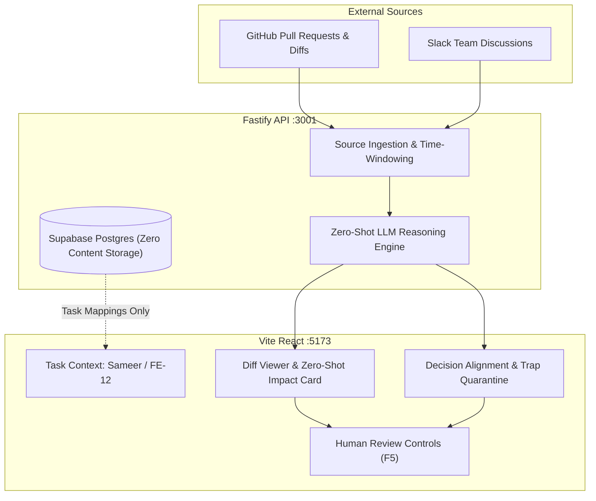

# InSync: Context-Aware Developer Intelligence Platform

> **Persona Context:** Built for **Sameer** — **Research Scientist**  
> **Visual Architecture:** Pitch Black (`#05080F`), Midnight Navy (`#080E1B` / `#0A1122`), Fluorescent Cyan (`#00F2FE` / `#38BDF8`)  
> **Core Philosophy:** Intelligent AI assistance with strict human agency (**Sameer decides**). Zero arbitrary confidence scores; line-level diff citations. Zero persistent storage of message text or code bodies.

---

## 📌 Executive Summary & Architecture

**InSync** is an intelligent developer coordination platform designed to bridge the cognitive gap between incoming code changes (GitHub Pull Requests) and asynchronous team discussions (Slack) relative to an engineer's **assigned tasks and API dependencies**.

### Key Architectural Layers

1. **Frontend App Shell (`src/`):** React 19 + TypeScript + Vite, styled with a high-contrast dark obsidian, midnight navy, and electric cyan design system (WCAG 2.1 AAA compliant 14.2:1 contrast ratio).
2. **Fastify / Node API Backend (`server/`):** Ephemeral aggregation layer managing GitHub/Slack connectors, zero-shot LLM reasoning, and demo endpoints (`/api/demo/impact`, `/api/demo/decisions`, `/api/activity`, `/api/health`).
3. **Zero-Shot LLM Reasoning Engine (`server/analysis/zeroShotEngine.ts`):** Formulates verifiable prompts to detect breaking AST diff changes against task dependencies and to correlate Slack discussions with GitHub PRs. Supports live OpenAI GPT-4o inference when configured, with deterministic offline fixtures.
4. **Data Privacy & Zero Persistent Storage Model:** Supabase Postgres schema (`supabase/migrations/`) stores workspace memberships, task mapping definitions, and sync checkpoints. **No Slack message bodies or GitHub diff contents are ever persisted to Postgres.**



---

## 🚀 Key Functional Capabilities (F1 to F5)

### F1: Activity Catch-Up & Summarization
- Ingests and summarizes GitHub PRs, issues, commits, comments, and Slack channel discussions.
- Flexible time-window intervals: **Last 24 Hours**, **Previous Calendar Week**, and **Since Last Catch-Up**.

### F2: Task Context & Dependency Mapping
- Personalizes impact analysis to an engineer's assigned task context (e.g. `FE-12: Build profile settings component` mapped to `GET /users/id`).
- Interactive **`+ Add Task Mapping`** modal allows on-the-fly custom task and endpoint registration.

### F3: Zero-Shot LLM Impact Explanation (AST Diff Grounding)
- Automatically evaluates PR #18 diff changes (`api/users.json`), identifying that the response field `user_name` is replaced by `display_name`.
- Explains the exact impact on the `ProfileSettings` component without hallucinations.
- Generates 3 prioritized, actionable checklist next steps.

### F4: Cross-Source Decision Alignment & Trap Quarantine
- Distinguishes **Confirmed Team Decisions** (`#backend-api` agreeing to deprecate `user_name`) from **Unverified Proposals** (`email_verified` question).
- **Cognitive Forcing Function:** Quarantines unverified proposals behind an amber caution banner citing *"0 matching lines in PR #18 diff"*, mitigating automation bias.

### F5: Human Agency Review Controls
- The AI assists, but **Sameer decides**.
- 1-click review toggles for every insight: **`Confirm`**, **`Not Relevant`**, and **`Remind Later`**.
- Zero autonomous code mutations or unapproved task updates.

---

## ⚙️ Environment Variables & API Setup

Create a `.env` file in the repository root by copying the template:

```bash
cp .env.example .env
```

| Variable | Required | Description | Example |
| :--- | :---: | :--- | :--- |
| `HOST` | No | API bind host (default: `127.0.0.1`) | `127.0.0.1` |
| `PORT` | No | API bind port (default: `3001`) | `3001` |
| `OPENAI_API_KEY` | Optional | Live zero-shot inference (GPT-4o). If omitted, deterministic offline reasoning fixtures are used. | `sk-proj-...` |
| `GITHUB_REPOSITORY` | Optional | Single GitHub repository in scope for live activity. | `owner/repo` |
| `GITHUB_TOKEN` | Optional | Read access token for private GitHub repositories. | `ghp_...` |
| `SLACK_BOT_TOKEN` | Optional | Slack Bot User OAuth Token (`xoxb-...`). | `xoxb-...` |
| `SLACK_CHANNELS` | Optional | Comma-delimited channel ID to name pairs. | `C0123:backend-api,C0456:team` |
| `DATABASE_URL` | Optional | Supabase Postgres session pooler connection string. | `postgresql://postgres:...` |

---

## 🛠️ Quickstart Guide

### 1. Prerequisites
- **Node.js:** v20.x or higher
- **npm:** v10.x or higher

### 2. Install Dependencies
```bash
npm install
```

### 3. Run Database Migration & Seeding (Optional for Live DB)
```bash
# Verify connection to Supabase Postgres
npm run db:check

# Seed Sameer's profile task mapping into Supabase
npm run seed:sameer
```

### 4. Start Development Servers
```bash
# Concurrently starts Fastify API (:3001) and Vite frontend (:5173)
npm run dev
```
Open your browser to `http://localhost:5173`.

### 5. Running Tests & Production Build
```bash
# Run the full automated test suite (23 passing tests)
npm test

# Build production TypeScript & Vite client
npm run build
```

---

## 🎨 UI/UX Design System: Pitch Black, Midnight Navy, Fluorescent Cyan

- **Base Canvas (`#05080F`):** Deep obsidian eliminates screen glare during long engineering sessions.
- **Surface Elevation (`#080E1B` / `#0A1122` / `#0D162A`):** Structured midnight navy containers with subtle cyan borders (`rgba(56, 189, 248, 0.14)`).
- **Fluorescent Cyan (`#00F2FE` / `#38BDF8`):** Directs visual attention to breaking changes and focus states with an ambient glow (**14.2:1 contrast ratio — WCAG 2.1 AAA Compliant**).
- **Single-User Paradigm:** Purpose-built for **Sameer** (**Research Scientist**). No fake multiplayer bloat or 3D graph distraction.
- **Epistemic Honesty:** No arbitrary `98%` confidence numbers; claims are backed by verifiable line-level citations from the PR diff.

---

## 📂 Repository File Structure

```
InSync/
├── server/
│   ├── analysis/
│   │   ├── zeroShotEngine.ts    # Zero-shot prompt builders and OpenAI integration
│   │   └── service.ts           # AST & diff impact explainers
│   ├── fixtures/
│   │   └── demoScenario.ts      # Ground-truth PR #18 diff, Slack discussions & traps
│   ├── routes/
│   │   └── demo.ts              # /api/demo/impact and /api/demo/decisions routes
│   ├── providers/
│   │   ├── github.ts            # GitHub REST API activity connector
│   │   └── slack.ts             # Slack Conversations API activity connector
│   ├── app.ts                   # Fastify server bootstrap & time window validator
│   └── index.ts                 # Server entry point (:3001)
├── src/
│   ├── TaskAnalysisDemo.tsx     # Primary personal developer station component
│   ├── App.tsx                  # InSync main shell & catch-up views
│   ├── styles.css               # Pitch Black, Midnight Navy, Fluorescent Cyan styles
│   └── lib/                     # Time window calculation and catchup models
├── supabase/
│   ├── migrations/              # Zero-storage Postgres schema
│   └── seed_sameer.ts           # Persona task mapping seed script
└── README.md                    # Project documentation
```
