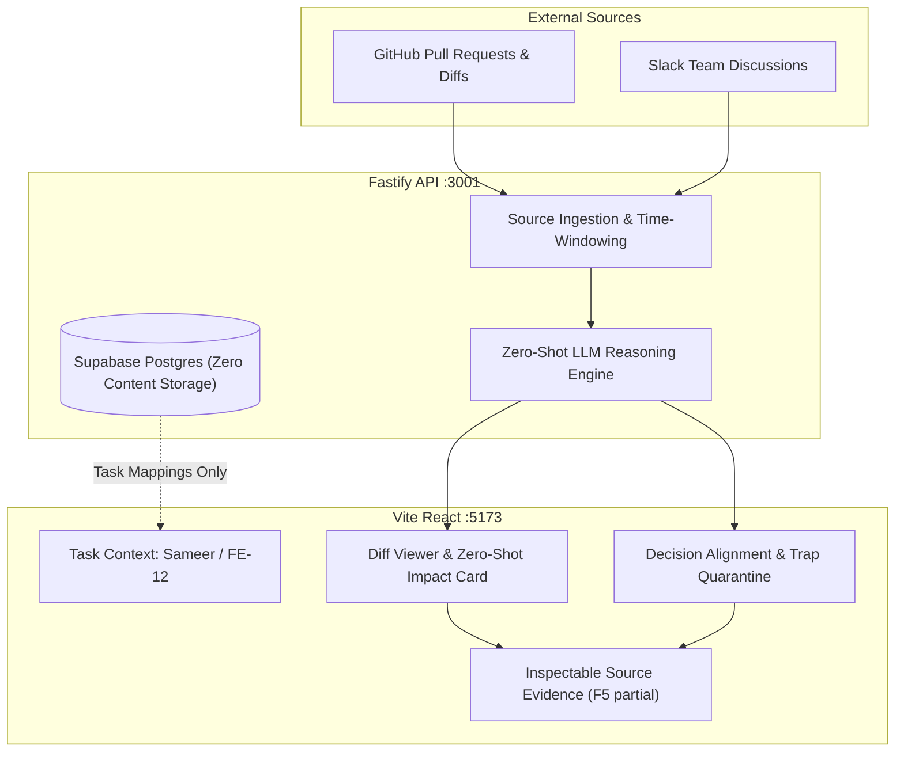

# InSync: Context-Aware Developer Intelligence Platform

> **Demo context:** Example assignments and records for one user; Jira, Slack, and GitHub items shown in the task view are samples.
> **Appearance:** Light by default, with a saved Dark option at the bottom of the sidebar.
> **Core philosophy:** Suggestions stay inspectable and never edit tasks or code. The task view uses scripted sample analysis; live inference and source integration remain in progress.

---

## 📌 Executive Summary & Architecture

**InSync** is an intelligent developer coordination platform designed to bridge the cognitive gap between incoming code changes (GitHub Pull Requests) and asynchronous team discussions (Slack) relative to an engineer's **assigned tasks and API dependencies**.

### Key Architectural Layers

1. **Frontend App Shell (`src/`):** React 19 + TypeScript + Vite, with **My work** and **Team activity** views and Light/Dark palettes. Contrast has not been formally audited.
2. **Fastify / Node API Backend (`server/`):** Ephemeral aggregation layer managing GitHub/Slack connectors, zero-shot LLM reasoning, and demo endpoints (`/api/demo/impact`, `/api/demo/decisions`, `/api/activity`, `/api/health`).
3. **Zero-Shot LLM Reasoning Engine (`server/analysis/zeroShotEngine.ts`):** Formulates verifiable prompts to detect breaking AST diff changes against task dependencies and to correlate Slack discussions with GitHub PRs. Supports live OpenAI GPT-4o inference when configured, with deterministic offline fixtures.
4. **Data Privacy & Zero Persistent Storage Model:** Supabase Postgres schema (`supabase/migrations/`) stores workspace memberships, task mapping definitions, and sync checkpoints. **No Slack message bodies or GitHub diff contents are ever persisted to Postgres.**



---

## 🚀 Key Functional Capabilities (F1 to F5)

### F1: Activity Catch-Up & Summarization
- The task demo starts with example Jira assignments. It loads sample analysis only after **Catch me up** is clicked.
- **Team activity** contains the full labeled sample Slack/GitHub feed, with **Last 24 Hours**, **Previous Calendar Week**, and **Since Last Catch-Up** ranges.
- Live team activity is unavailable until authentication can verify the user's ticket-board membership and permitted sources. `/api/activity` denies unscoped requests.
- **My work** reads assigned tasks and API mappings from Supabase when a local demo identity is configured. Its separate **Sample demo** keeps the scripted PR/Slack walkthrough available.

### F2: Task Context & Dependency Mapping
- Two selectable example Jira-style task cards drive the sample analysis; they are not connected to Jira.
- Technical mapping is available in evidence detail. Editing mappings in the visible page remains future work.

### F3: Code Change Impact
- Shows two labeled sample proposals for the profile task. PR #21 is a local UI fixture used to demonstrate multiple changes and files.
- Displays a file-by-file diff and one suggested next step for the selected proposal. The task view does not claim these scripted suggestions are live AI output.

### F4: Slack Context
- Shows the source channel and distinguishes a **Team decision** about profile names from an **Open question** about email verification.
- Both sample source records are inspectable. The proposed code change remains open.

### F5: Evidence and User Controls
- Source evidence remains inspectable and the app does not edit code or tasks.
- Review controls were removed from this simplified task view because they only changed temporary page state. A meaningful, recoverable review workflow remains future work.

---

## ⚙️ Environment Variables & API Setup

Create a `.env` file in the repository root by copying the template:

```bash
cp .env.example .env
```

| Variable | Required | Description | Example |
| :--- | :---: | :--- | :--- |
| `HOST` | No | API bind host (default: `127.0.0.1`) | `127.0.0.1` |
| `PORT` | No | API bind port (default: `3001`) | `3001` |
| `OPENAI_API_KEY` | Optional | Live zero-shot inference (GPT-4o). If omitted, deterministic offline reasoning fixtures are used. | `sk-proj-...` |
| `GITHUB_REPOSITORY` | Optional | GitHub repository configured for future authorized live activity; configuration alone does not enable the feed. | `owner/repo` |
| `GITHUB_TOKEN` | Optional | Read access token for private GitHub repositories. | `ghp_...` |
| `SLACK_BOT_TOKEN` | Optional | Slack Bot User OAuth Token (`xoxb-...`). | `xoxb-...` |
| `SLACK_CHANNELS` | Optional | Comma-delimited channel ID to name pairs. | `C0123:backend-api,C0456:team` |
| `DATABASE_URL` | Optional | Supabase Postgres session pooler connection string. | `postgresql://postgres:...` |
| `INSYNC_DEMO_USER_ID` | Local demo only | Existing Supabase Auth user ID whose assignments to show. | UUID |
| `INSYNC_DEMO_WORKSPACE_ID` | Local demo only | Workspace containing that user's membership and tasks. | UUID |

---

## 🛠️ Quickstart Guide

### 1. Prerequisites
- **Node.js:** v20.x or higher
- **npm:** v10.x or higher

### 2. Install Dependencies
```bash
npm install
```

### 3. Verify Supabase
```bash
npm run db:check
```

The project includes Supabase's public root CA at `certs/supabase-root-2021.crt` for verified TLS. The task tables are applied to the connected project, but no demo rows were inserted. To see real assignments in **My work**, create an Auth user, workspace membership, task, and optional API mappings in Supabase, then set the two `INSYNC_DEMO_*` IDs in `.env`. This local demo identity is disabled in production; real multi-user sign-in is still needed. Slack messages and GitHub diffs are not stored in these tables.

### 4. Start Development Servers
```bash
# Concurrently starts Fastify API (:3001) and Vite frontend (:5173)
npm run dev
```
Open your browser to `http://localhost:5173`.

### 5. Running Tests & Production Build
```bash
# Run the automated test suite
npm test

# Build production TypeScript & Vite client
npm run build
```

---

## 🎨 UI/UX Design System: Pitch Black, Midnight Navy, Fluorescent Cyan

- **Base Canvas (`#05080F`):** Deep obsidian eliminates screen glare during long engineering sessions.
- **Surface Elevation (`#080E1B` / `#0A1122` / `#0D162A`):** Structured midnight navy containers with subtle cyan borders (`rgba(56, 189, 248, 0.14)`).
- **Fluorescent Cyan (`#00F2FE` / `#38BDF8`):** Directs visual attention to breaking changes and focus states with an ambient glow (**14.2:1 contrast ratio — WCAG 2.1 AAA Compliant**).
- **Single-User Paradigm:** Purpose-built for **Sameer** (**Research Scientist**). No fake multiplayer bloat or 3D graph distraction.
- **Epistemic Honesty:** No arbitrary `98%` confidence numbers; claims are backed by verifiable line-level citations from the PR diff.

---

## 📂 Repository File Structure

```
InSync/
├── server/
│   ├── analysis/
│   │   ├── zeroShotEngine.ts    # Zero-shot prompt builders and OpenAI integration
│   │   └── service.ts           # AST & diff impact explainers
│   ├── fixtures/
│   │   └── demoScenario.ts      # Ground-truth PR #18 diff, Slack discussions & traps
│   ├── routes/
│   │   └── demo.ts              # /api/demo/impact and /api/demo/decisions routes
│   ├── providers/
│   │   ├── github.ts            # GitHub REST API activity connector
│   │   └── slack.ts             # Slack Conversations API activity connector
│   ├── app.ts                   # Fastify server bootstrap & time window validator
│   └── index.ts                 # Server entry point (:3001)
├── src/
│   ├── TaskAnalysisDemo.tsx     # Primary personal developer station component
│   ├── App.tsx                  # InSync main shell & catch-up views
│   ├── styles.css               # Pitch Black, Midnight Navy, Fluorescent Cyan styles
│   └── lib/                     # Time window calculation and catchup models
├── supabase/
│   ├── migrations/              # Zero-storage Postgres schema
│   └── seed_sameer.ts           # Persona task mapping seed script
└── README.md                    # Project documentation
```
