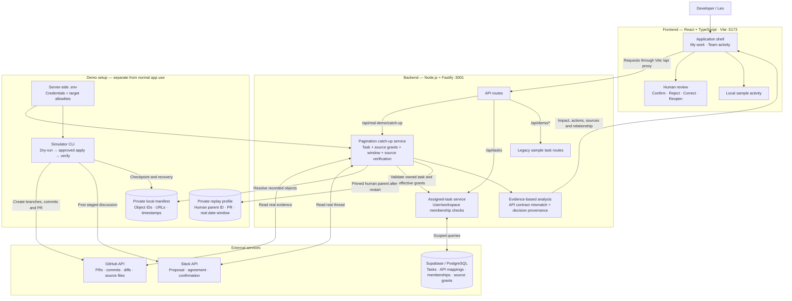

# InSync architecture

The application shares a task-selected evidence snapshot and relationship review across My work and Team activity. It re-fetches the existing GitHub PR and pinned human DEC-15 thread for every walkthrough. An optional simulator originally created the isolated PR and a separate staged bot discussion; ordinary replay performs read-only requests. Explicit offline mode uses labeled samples.

## System diagram

## Connected workflows

Both interactions use the evidence returned by the catch-up request. “Why did this change?” expands the already-loaded provenance rather than issuing another model call.

```mermaid
flowchart LR
    TASK["Select assigned task + mapping"] --> A["Catch me up"]
    A --> B["Authorize task/sources; retrieve PR, code and Slack thread"]
    B --> C["Detect totalPages removal"]
    C --> D["Check selected component/API/field mapping"]
    D --> E["Impact explanation + action plan"]
    E --> F["Why did this change?"]
    F --> G["Human proposal → agreement → DEC-15 → PR"]
    G --> H["Human confirms, rejects or corrects the link"]
    H --> FEED["Same evidence + review in Team activity"]
    FEED --> RESET["Reset result/review; keep task + replay settings"]
```

## Implementation boundaries

- Pagination analysis uses inspectable evidence rules, source links and uncertainty. It does not call OpenAI. The optional model engine in the legacy sample routes is separate.
- Source decision status and human link review are independent. DEC-15 can be confirmed while its relationship to a PR remains a possible match awaiting review.
- Supabase supplies member-owned assignments and inspectable mappings in My work. Both source grants are required before live readback. ProductList → GET /products → totalPages gates the supported consumer impact; unrelated or missing mappings yield uncertainty. Mapping editing and discovery remain unimplemented.
- Human review applies to the loaded result in browser state. It does not edit Slack, GitHub, source decision status or project tasks. Remind Later records a local deferral rather than scheduling a notification.
- Team activity displays the selected scenario’s retrieved evidence with real date/provider filtering and shared review. Separate illustrative samples remain under a disclosure. The optional new-human-thread mode uses Socket Mode for metadata discovery. General `/api/activity` still requires authenticated ticket-board/source grants; startup does not provide that production resolver.
- The live pagination endpoint is restricted to non-production, loopback-bound demo use. Credentials stay on the server. Private simulator journals and identifier/date-only replay profiles stay in ignored `.demo/`. A local env identity supplies one demo user; production authentication is not implemented.
- The simulator creates genuine remote objects with visibly staged content and simulated weekday labels. Platform IDs and timestamps remain real. It does not merge the PR or deploy the changed API.

## Code map

| Component | Files |
| --- | --- |
| App shell, navigation and themes | [src/App.tsx](../src/App.tsx), [src/palette.css](../src/palette.css) |
| Shared walkthrough and human review | [src/PaginationDemo.tsx](../src/PaginationDemo.tsx), [src/lib/real-demo.ts](../src/lib/real-demo.ts), [src/useWalkthrough.ts](../src/useWalkthrough.ts), [src/ScenarioActivity.tsx](../src/ScenarioActivity.tsx) |
| Frontend API proxy | [vite.config.ts](../vite.config.ts) |
| Backend startup and routes | [server/index.ts](../server/index.ts), [server/app.ts](../server/app.ts), [server/real-demo/routes.ts](../server/real-demo/routes.ts) |
| Real source retrieval and analysis | [server/real-demo/api.ts](../server/real-demo/api.ts), [server/real-demo/analysis.ts](../server/real-demo/analysis.ts) |
| Simulator and recovery journal | [server/real-demo/cli.ts](../server/real-demo/cli.ts), [server/real-demo/simulator.ts](../server/real-demo/simulator.ts), [server/real-demo/manifest.ts](../server/real-demo/manifest.ts) |
| Supabase assigned tasks | [server/db/tasks.ts](../server/db/tasks.ts), [src/lib/tasks.ts](../src/lib/tasks.ts) |
| Setup and live walkthrough | [WORKSPACE_DEMO.md](WORKSPACE_DEMO.md), [server/real-demo/task-setup.ts](../server/real-demo/task-setup.ts), [server/real-demo/replay.ts](../server/real-demo/replay.ts) |

## Optional live human-thread collection

```mermaid
flowchart LR
    HUMAN["Human posts in approved channel"] --> SLACK["Slack Events API"]
    SLACK -->|"Socket Mode / xapp token"| LISTENER["Official Socket Mode client"]
    LISTENER -->|"acknowledge + scope + deduplicate"| INDEX["Bounded in-memory thread metadata"]
    INDEX -->|"metadata polling"| SELECTOR["Human thread selector"]
    SELECTOR -->|"Catch me up"| LOADER["Fetch full thread + known GitHub PR"]
    LOADER --> RULES["Evidence rules + independent human review"]
```

Source text is fetched on demand with the existing bot token. No human message bodies are persisted. The discovery index clears on restart, does not backfill arbitrary historical events, and is limited to the local demo. Saved DEC-15 replay reads its pinned parent directly after restart without another event. Setup and a step-by-step simulation are in [SLACK_EVENTS_DEMO.md](SLACK_EVENTS_DEMO.md).

Live verification: the Socket Mode path received three human messages in one thread on 2026-11-08. The running catch-up route resolved DEC-15 and ProductList impact while preserving the separate unverified relationship review.
