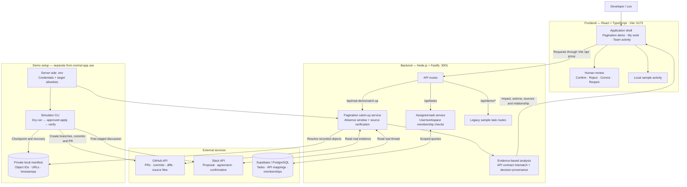
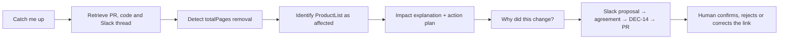

# InSync architecture

This describes the current implementation after integrating upstream commit `99ad059` with the real pagination demo. The simulator creates staged records on GitHub and Slack; the application retrieves and analyzes those real records. The explicit offline mode uses labeled samples.

## System diagram

## Connected workflows

Both interactions use the evidence returned by the catch-up request. “Why did this change?” expands the already-loaded provenance rather than issuing another model call.

## Implementation boundaries

- Pagination analysis uses inspectable evidence rules, source links and uncertainty. It does not call OpenAI. The optional model engine in the legacy sample routes is separate.
- Source decision status and human link review are independent. DEC-14 can be confirmed while its relationship to a PR remains a possible match awaiting review.
- Supabase supplies assigned tasks and mappings in My work. Those assignments are not yet connected to the pagination analyzer, which uses the predefined Leo/ProductList mapping.
- Human review applies to the loaded result in browser state. It does not edit Slack, GitHub, source decision status or project tasks. Remind Later records a local deferral rather than scheduling a notification.
- Team activity currently displays samples. The separate human-thread mode uses an optional Socket Mode listener for approved-channel metadata discovery. Its general live endpoint requires authenticated ticket-board/source grants; the current server startup does not provide that resolver.
- The live pagination endpoint is restricted to non-production, loopback-bound demo use. Credentials stay on the server. Private simulator journals stay in the ignored `.demo/` directory.
- The simulator creates genuine remote objects with visibly staged content and simulated weekday labels. Platform IDs and timestamps remain real. It does not merge the PR or deploy the changed API.

## Code map

| Component | Files |
| --- | --- |
| App shell, navigation and themes | [src/App.tsx](../src/App.tsx), [src/palette.css](../src/palette.css) |
| Pagination interaction and human review | [src/PaginationDemo.tsx](../src/PaginationDemo.tsx), [src/lib/real-demo.ts](../src/lib/real-demo.ts) |
| Frontend API proxy | [vite.config.ts](../vite.config.ts) |
| Backend startup and routes | [server/index.ts](../server/index.ts), [server/app.ts](../server/app.ts), [server/real-demo/routes.ts](../server/real-demo/routes.ts) |
| Real source retrieval and analysis | [server/real-demo/api.ts](../server/real-demo/api.ts), [server/real-demo/analysis.ts](../server/real-demo/analysis.ts) |
| Simulator and recovery journal | [server/real-demo/cli.ts](../server/real-demo/cli.ts), [server/real-demo/simulator.ts](../server/real-demo/simulator.ts), [server/real-demo/manifest.ts](../server/real-demo/manifest.ts) |
| Supabase assigned tasks | [server/db/tasks.ts](../server/db/tasks.ts), [src/lib/tasks.ts](../src/lib/tasks.ts) |
| Setup and live walkthrough | [REAL_DATA_DEMO.md](REAL_DATA_DEMO.md) |

## Optional live human-thread collection

```mermaid
flowchart LR
    HUMAN["Human posts in approved channel"] --> SLACK["Slack Events API"]
    SLACK -->|"Socket Mode / xapp token"| LISTENER["Official Socket Mode client"]
    LISTENER -->|"acknowledge + scope + deduplicate"| INDEX["Bounded in-memory thread metadata"]
    INDEX -->|"metadata polling"| SELECTOR["Human thread selector"]
    SELECTOR -->|"Catch me up"| LOADER["Fetch full thread + known GitHub PR"]
    LOADER --> RULES["Evidence rules + independent human review"]
```

Source text is fetched on demand with the existing bot token. No human message bodies are persisted. The index clears on restart, does not backfill historical events, and is limited to the local demo. Setup and a step-by-step simulation are in [SLACK_EVENTS_DEMO.md](SLACK_EVENTS_DEMO.md).

Live verification: the Socket Mode path received three human messages in one thread on 2026-11-08. The running catch-up route resolved DEC-15 and ProductList impact while preserving the separate unverified relationship review.
